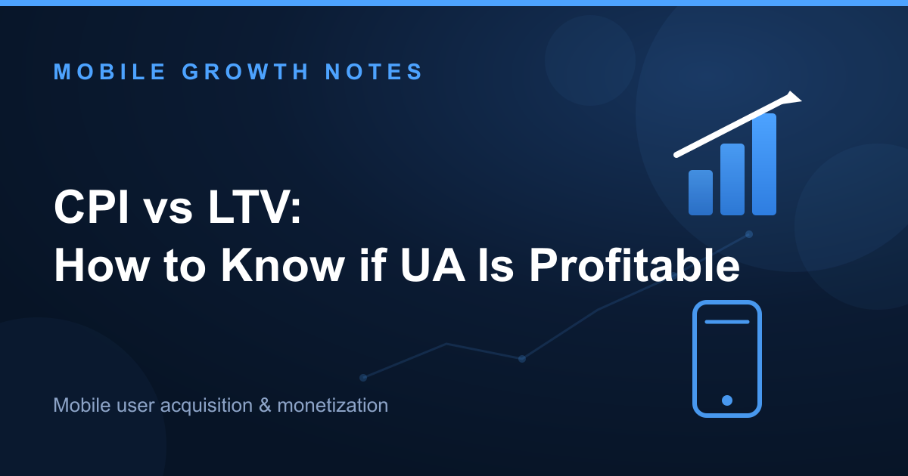

The fundamental rule for profitable user acquisition is simple: **LTV > CPI**.

Your user's Lifetime Value must exceed their Cost Per Install. If it doesn't, every install loses money, and no amount of creative optimization will fix broken unit economics.

This guide goes beyond the basic formula. You'll learn how to calculate profitability in practice, understand how ROAS fits into day-to-day optimization, and avoid expensive mistakes that drain UA budgets—like chasing cheap installs that never monetize.

## The Core Equation: LTV > CPI

Before you can determine whether your UA is profitable, you need to understand what these two metrics actually measure.

**Cost Per Install (CPI)** is the direct cost to acquire one new user through a specific paid channel. The formula is straightforward: `Total Ad Spend / Total Installs`.

If you spend $1,500 on a campaign and acquire 1,000 installs, your CPI is $1.50.

**Lifetime Value (LTV)** is the total *net revenue* a single user is predicted to generate throughout their entire time in your app. This includes revenue from In-App Purchases (IAP), Ad Monetization, and Subscriptions.

The relationship between these two metrics determines profitability: **LTV > CPI** is the only sustainable path to growth. If this inequality doesn't hold, every user you acquire loses money.

[According to AppsFlyer, LTV is the north star metric](https://www.appsflyer.com/blog/measurement-analytics/customer-lifetime-value) for sustainable growth, shifting focus from acquisition cost to user quality.

## Unit Economics in Action: A Step-by-Step Profitability Calculation

Let's walk through a real profitability calculation where theory meets practice.

**Illustrative example:** You're analyzing a campaign for a mid-core game targeting users in the US.

Here are your core numbers:
- **Campaign Spend:** $1,500
- **Total Installs:** 1,000
- **CPI:** $1.50 ($1,500 / 1,000)

Now, let's track how much revenue this cohort generates over time.

| Day (D) | D(n) ARPU | Cumulative ARPU | Is UA Profitable Yet? (Cumulative ARPU vs CPI) |
|---------|-----------|-----------------|------------------------------------------------|
| D0 | $0.15 | $0.15 | No ($0.15 < $1.50) |
| D7 | $0.35 | $0.50 | No ($0.50 < $1.50) |
| D30 | $0.50 | $1.00 | No ($1.00 < $1.50) |
| D90 | $0.60 | $1.60 | **Yes ($1.60 > $1.50)** |
| D180 | $0.80 | **$2.40 (Predicted LTV)** | **Yes, and profitable** |

Here's what's happening at each stage:

**Day 0:** You've spent $1.50 per user but only generated $0.15 in revenue. You're deep in the red.

**Day 7 to Day 30:** Revenue is accumulating, but you're still underwater. The campaign hasn't paid back its acquisition cost yet.

**Day 90:** This is your **payback window**—the point where cumulative revenue ($1.60) finally exceeds your CPI ($1.50). The campaign is now cash-flow positive.

**Day 180:** Your predicted LTV is $2.40. For every $1.50 you spent, you've generated $2.40 in revenue. The UA is clearly profitable.

Final profitability: `($2.40 LTV - $1.50 CPI) = $0.90` profit per user.

This is the balance sheet for your cohort. If you can't run this calculation for your campaigns, you're flying blind.

## Introducing ROAS: The KPI You Actually Optimize For

LTV and CPI tell you whether your UA is profitable. But in day-to-day operations, you optimize for a different metric: **Return on Ad Spend (ROAS)**.

ROAS measures how much revenue you generate for every dollar you spend on advertising. The formula is: `(Revenue from Ad Campaign / Cost of Ad Campaign) * 100%`.

Using the numbers from our illustrative example:

**ROAS = ($2.40 LTV / $1.50 CPI) * 100% = 160%**

In plain language: for every $1 you invested in this campaign, you got $1.60 back.

Here's how ROAS connects to profitability: **A 100% ROAS is your break-even point** (LTV = CPI). Profitable UA requires ROAS > 100%.

LTV and CPI determine your *target* ROAS. Day-to-day optimization relies on tracking early ROAS benchmarks—like D7 or D30 ROAS—to predict whether a campaign will hit that target.

[As Unity's guide on UA highlights](https://unity.com/resources/mobile-game-user-acquisition-guide), ROAS is the metric you actually optimize, while LTV and CPI define whether that ROAS target delivers profitability.

You can learn more in our detailed guide to **calculating and optimizing ROAS**.

## Beyond the Metrics: Strategic Implications for Your UA

Many teams make the same costly mistake: they chase cheap installs without understanding the full picture.

A $0.15 CPI in LATAM might be unprofitable, while a $4.00 CPI in a Tier-1 country could be your best-performing campaign. Here's why.

### The "Cheap Installs" Fallacy

CPI is meaningless without LTV context.

Here's the scenario: You run a campaign in LATAM and acquire users at $0.15 CPI. On the surface, this looks incredible—installs are cheap, and volume is high.

But if that $0.15 CPI user only generates an LTV of $0.10, you're losing 33% on every install. The low CPI is a trap.

In contrast, a $4.00 CPI user in the US with an LTV of $6.00 delivers $2.00 profit per user. The "expensive" install is actually highly profitable.

Why does this happen? Lower-tier geos often have proportionally lower monetization potential due to lower ad eCPMs and weaker IAP spending power.

[Regional CPI benchmarks from Adjust](https://www.adjust.com/blog/mobile-game-user-acquisition-strategy) show these vast differences, but they don't tell the full story without LTV context.

### Advanced KPIs That Matter

Smart UA teams look beyond blended CPI. Focus on metrics that are closer to revenue.

**Cost per Paying User (CPPU):** For IAP-driven apps, this is your true acquisition cost. If 5% of your users pay, and your CPI is $2.00, your CPPU is $40.00.

**Cost per Retained User (CPRU):** Calculate the cost to acquire a user who is still active at D30. This filters out low-quality churn and shows you what you're really paying for engaged users.

### The Importance of Payback Windows

Cash flow impacts UA strategy just as much as ultimate profitability.

A campaign with a 180-day payback window might be profitable on paper, but it creates cash flow challenges for small studios. You're waiting six months to recover your spend.

Hypercasual games often need payback in under 7 days. Strategy games might tolerate 12+ months. This is a business decision, not just a marketing one.

[Industry strategists often emphasize that the speed of capital recycling](https://www.mobiledevmemo.com) is as important as the ultimate ROI.

## How to Accurately Measure LTV and CPI

Accurate measurement is non-negotiable. If your attribution is broken, every decision you make will be wrong.

**Mobile Measurement Partners (MMPs):** Using an MMP like AppsFlyer, Adjust, or Singular is the industry standard for attributing installs and in-app events to specific UA campaigns. This is how you calculate CPI per channel and track revenue back to the source.

**LTV Calculation:** There are two approaches.

**Historical LTV** calculates the actual revenue from past cohorts. This is reliable but slow—you're looking backward at completed lifecycles.

**Predictive LTV** uses machine learning models to forecast a new user's LTV based on early signals like D1/D3 engagement, tutorial completion, or first-session behavior. This allows for faster optimization.

[As the industry shifts towards privacy-centric measurement](https://www.singular.net/blog/rewarded-user-acquisition), robust LTV modeling becomes even more critical for effective UA.

## It's Not About Cheap Installs, It's About Profitable Growth

The goal of UA is not to find the lowest CPI. It's to find the most profitable LTV-to-CPI ratio.

Stop asking "What is my CPI?" and start asking "What is my ROAS on Day 90, and is it profitable?"

The answer to that question, guided by the **LTV > CPI** principle, is the key to scaling your app sustainably.