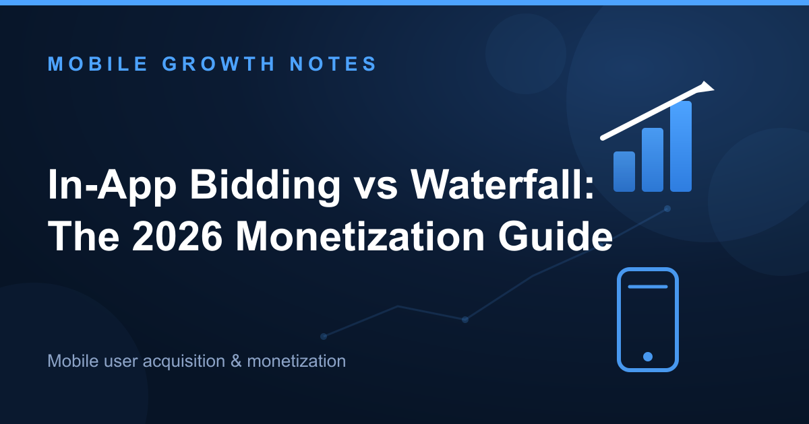

The mobile ad monetization stack has fundamentally changed. The sequential waterfall model that dominated for years has been replaced by parallel in-app bidding. Today, most sophisticated publishers run a hybrid configuration that combines both approaches.

This shift isn't just technical—it represents a move from predicting revenue based on historical data to capturing it through real-time auctions. That change directly impacts your eCPM, fill rate, and ultimately your ARPDAU.

## The Old Guard: Deconstructing the Waterfall Model

### How It Worked: A Sequential Process

The waterfall mechanism was straightforward but inefficient. Your mediation SDK called ad networks one by one, ranked by their historical [eCPM](/how-to-increase-ecpm/).

The flow looked like this:

1. SDK requests an ad from Network A at a $10 floor.
2. If Network A fails to fill or times out, the SDK calls Network B at an $8 floor.
3. This continues down the chain until an ad fills or the list is exhausted.

Each network got a chance to fill the impression at a pre-set price point. If it passed, the request moved to the next tier.

### The Counter-Intuitive Flaw: Why "Highest eCPM" Wasn't Highest Revenue

Here's the problem most developers miss: **the waterfall's reliance on historical averages means you consistently miss real-time opportunities.**

Network C, ranked third in your waterfall, might have been willing to pay $12 for that specific impression. But because Network A filled it at $10, Network C never saw the request. You left $2 on the table.

This is the core economic inefficiency of the waterfall model. You're not maximizing revenue per impression—you're filling impressions based on outdated predictions.

The second major flaw is latency. Each network call adds delay, especially when timeouts occur. A five-tier waterfall with 3-second timeouts per tier can add 15 seconds of cumulative delay before an ad fills. That degrades user experience and increases abandonment rates.

## How In-App Bidding Works: A Real-Time Auction

### A Unified, Real-Time Auction

In-app bidding, also called parallel bidding, runs a unified auction for each impression. Instead of calling networks sequentially, it asks all demand sources to compete simultaneously.

The flow is fundamentally different:

1. SDK sends a bid request to all connected demand sources (bidders) at the same time.
2. All bidders submit a real-time bid for that single impression.
3. The highest bid wins the auction and shows the ad.

**Every demand source gets to compete for every impression.** That's the structural change that matters.

As [analysis on MobileDevMemo has shown](https://mobiledevmemo.com/), this shift to a unified auction was the single most important structural change in mobile ad monetization in the last decade.

### The Direct Benefits

The advantages are measurable:

- **Increased Revenue:** True price discovery from competition drives up average eCPMs.

**Illustrative example:** Suppose five demand sources bid $8, $10, $12, $9, and $11 for the same impression.

| Model | Winning price | eCPM | Revenue per 1,000 impressions |
|:---|:---|:---|:---|
| Waterfall (first network fills at a $10 floor) | $10 | $10 | $10 |
| In-app bidding (highest bid wins) | $12 | $12 | $12 |

With bidding you earn $12 instead of $10 — a 20% lift per impression. On 10 million impressions a month, that is an extra $20,000 a month, or $240,000 a year, on identical inventory.
- **Reduced Latency:** A single, parallel auction call with a fixed timeout is much faster than a chain of sequential calls. Instead of waiting for five timeouts, you wait for one.
- **Operational Efficiency:** You eliminate the manual work of ordering and re-ordering waterfall placements based on weekly eCPM reports.

[Reports from outlets like PocketGamer.biz](https://www.pocketgamer.biz/) have consistently highlighted the revenue lift developers see after adopting bidding.

## In-App Bidding vs. Waterfall: A Head-to-Head Comparison

The table below breaks down the key operational and financial differences between the two models.

| Feature | Waterfall Mediation | In-App Bidding |
|:---|:---|:---|
| **Mechanism** | Sequential calls to networks based on historical eCPM. | Parallel, real-time auction where all bidders compete at once. |
| **Speed/Latency** | High. Latency is cumulative as each network in the chain can time out. | Low. A single auction call with one timeout period. |
| **Fill Rate** | Can be high, but often at the cost of lower-quality, low-CPM backfill. | Can be lower if there are few bidders. Often supplemented by a waterfall. |
| **Revenue (Yield)** | Sub-optimal. Leaves money on the table by not letting all networks bid. | Higher. Maximizes revenue per impression through real-time competition. |
| **Integration Complexity** | High operational overhead. Requires constant manual ranking and optimization. | Simpler operationally once set up. Less day-to-day management needed. |

Fill rate and revenue require nuance. While bidding maximizes revenue on filled impressions, it doesn't guarantee a fill. If only two bidders compete and both pass, the impression goes unfilled. That's why the modern stack evolved beyond a pure bidding model.

## The Modern Playbook: Why the Hybrid Model Now Dominates

### Best of Both Worlds

The debate is no longer a strict "in-app bidding vs waterfall" choice. The standard is now a **bidding-first hybrid model.**

The structure works like this:

1. An in-app bidding auction runs first, with multiple bidders competing in parallel.
2. If the auction produces no winning bid, or if the winning bid falls below a certain floor, the request passes to a short, traditional waterfall.

This setup captures maximum revenue from real-time competition via bidding, while using the waterfall as a backstop to ensure high fill rates. It also includes valuable ad networks that may not yet support bidding.

[As leading mediation platforms now architect their systems](https://unity.com/), the hybrid model is the default. For instance, [Unity's move to deprecate traditional ad waterfalls](https://discussions.unity.com/t/important-unity-ads-waterfall-deprecation-action-required-by-january-31-2026/1704939) for major partners signals the industry-wide commitment to a bidding-first future.

### My Experience with Hybrid Setups

From my experience managing monetization for a portfolio of apps, the switch to a hybrid model consistently delivers a 15-25% ARPDAU lift over a pure waterfall setup (illustrative example).

The key is to run the top 5-7 bidders who drive 80% of the value, then use a 2-3 tier waterfall to catch any remaining impressions. This eliminates the operational headache of managing a 20-tier waterfall while ensuring you don't sacrifice fill rate.

I've also found that setting dynamic floors based on user segment and geography makes a measurable difference. A Tier 1 rewarded video impression should have a floor of $8-12, while a Tier 3 banner might floor at $0.50. The hybrid model gives you the flexibility to enforce those floors without losing fill.

## The Shift from Prediction to Real-Time Performance

The industry has moved from a system based on predicting value through historical eCPM to one that discovers value in real-time through bidding.

The waterfall isn't entirely dead, but its role has permanently changed. It's now a supporting player, not the star of the show.

If your stack is still waterfall-dominant, your primary strategic goal should be to integrate bidders and transition to a hybrid model to remain competitive. [As industry data consistently shows](https://www.airbridge.io/), this transition is not just a trend, but a necessary evolution for maximizing ad revenue.

---

**About the author:** I help app developers scale user acquisition and monetization. 5+ years in digital marketing, now focused on programmatic advertising and offerwall. [Let's connect on LinkedIn](https://www.linkedin.com/in/mika-lee-0a920044a/)

